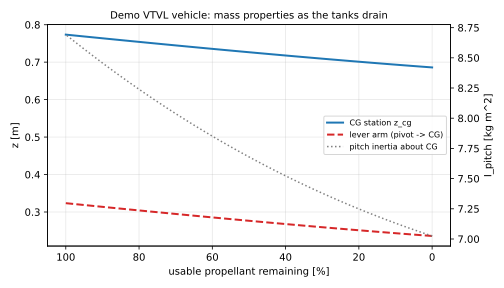

# rocket-massprops

**Mass, centre-of-gravity and moment-of-inertia budgets for small vertical rockets and VTVL hoppers -- including how the thrust-vector-control lever arm and control authority change as the tanks drain.**

[](https://github.com/sushkoivan/rocket-massprops/actions/workflows/ci.yml)


## Why it matters

A gimballed engine steers a rocket by tilting the thrust line about a pivot. The control moment is

$$M = T \sin\delta \cdot \ell, \qquad \ell = z_{cg} - z_{pivot}$$

so the moment you get per degree of gimbal depends on the **lever arm** $\ell$ between the pivot and the centre of gravity. On a hopper that lever arm is *not* a constant: as the oxidiser and fuel drain, the CG moves, the mass drops and the pitch inertia shrinks. The angular acceleration $\alpha = M/I$ can change by tens of percent between lift-off and landing -- exactly when the controller needs to be most precise.

Guidance, navigation & control (GNC) engineers therefore need the **whole curve** -- $m$, $z_{cg}$, $I$ and $\ell$ versus propellant remaining -- not a single number from a CAD screenshot. `rocket-massprops` gives that curve from a short JSON file long before a full CAD assembly exists, and keeps the mass budget (growth allowances, maturity, what-if sensitivities) in the same place.



## Features

- Stick model of a vertical vehicle: dry components + propellant tanks, each an axisymmetric segment on the vehicle axis.
- Propellant as a **liquid column settled at the tank bottom** that shrinks with fill, or **uniform depletion** (e.g. a core-burning solid grain).
- Unusable **residuals** stay on board at fill = 0.
- Pitch/yaw inertia about the CG (solid-cylinder or thin-tube segments + parallel axis), roll inertia.
- **TVC lever arm** and a **control-authority table** (side force, moment, angular and lateral acceleration, T/W) per gimbal angle and fill.
- **Growth allowances** per component (added at the component's own location) and a maturity summary.
- **Sensitivity**: what does +1 kg here do to CG, lever arm and inertia?
- JSON in, tables / CSV / PNG out. Command-line interface included.
- Pure standard library at runtime, Python >= 3.9. Matplotlib is optional (plots only).

## Install

```bash
pip install git+https://github.com/sushkoivan/rocket-massprops
# with plotting support
pip install "rocket-massprops[plot] @ git+https://github.com/sushkoivan/rocket-massprops"
```

## Quickstart -- Python

```python
from massprops import Component, PropellantTank, Vehicle

v = Vehicle(
    components=[
        Component("engine",   6.0, 0.10, 0.40, radius=0.06, growth=0.08),
        Component("airframe", 5.0, 0.10, 1.50, shape="tube", growth=0.15),
        Component("avionics", 2.2, 1.35, 1.50, growth=0.03),
    ],
    tanks=[
        PropellantTank("fuel",     4.0, 0.50, 0.85, density=800,  inner_radius=0.09, residual_fraction=0.03),
        PropellantTank("oxidiser", 8.5, 0.90, 1.35, density=1140, inner_radius=0.09, residual_fraction=0.03),
    ],
    radius=0.10,      # default radius for inertia [m]
    pivot_z=0.42,     # gimbal pivot station [m]
)

for s in v.table([1.0, 0.5, 0.0]):
    print(f"fill {s.fill:.1f}: m = {s.mass:5.2f} kg  z_cg = {s.cg:.3f} m  "
          f"I = {s.inertia_transverse:.2f} kg m^2  lever = {s.lever_arm:.3f} m")

for a in v.control_authority(thrust=400, deflections_deg=[5], fill=0.0):
    print(f"empty, 5 deg: M = {a.moment:.1f} N m, alpha = {a.angular_accel_deg:.0f} deg/s^2")

(d,) = v.sensitivity("avionics", +1.0, fills=[1.0])
print(f"+1 kg avionics: CG {d['d_cg']*1000:+.0f} mm, lever {d['d_lever']*1000:+.0f} mm, I {d['d_inertia']:+.2f} kg m^2")
```

Output:

```text
fill 1.0: m = 27.00 kg  z_cg = 0.768 m  I = 4.63 kg m^2  lever = 0.348 m
fill 0.5: m = 20.93 kg  z_cg = 0.710 m  I = 3.99 kg m^2  lever = 0.290 m
fill 0.0: m = 14.87 kg  z_cg = 0.655 m  I = 3.58 kg m^2  lever = 0.235 m
empty, 5 deg: M = 8.2 N m, alpha = 131 deg/s^2
+1 kg avionics: CG +24 mm, lever +24 mm, I +0.43 kg m^2
```

## Quickstart -- command line

```bash
python -m massprops examples/hopper.json --fills 1,0.5,0 --thrust 600 --gimbal 5,10,15
```

```text
Demo VTVL vehicle: dry 32.82 kg (growth 3.12 kg incl.), propellant 14.00 kg, radius 0.100 m, pivot z = 0.450 m

fill  m [kg]  prop [kg]  z_cg [m]  I_pitch [kg m2]  I_roll [kg m2]  lever [m]
----  ------  ---------  --------  ---------------  --------------  ---------
1.00   46.82      14.00    0.7735            8.692          0.7325     0.3235
0.50   40.03       7.21    0.7265            7.680          0.7012     0.2765
0.00   33.24       0.42    0.6859            7.025          0.6699     0.2359

Control authority (T = 600 N; M = T sin(delta) * lever)
fill  T [N]   T/W  delta [deg]  F_side [N]  M [N m]  alpha [deg/s2]  a_lat [m/s2]
----  -----  ----  -----------  ----------  -------  --------------  ------------
1.00  600.0  1.31            5        52.3    16.92           111.5          1.12
1.00  600.0  1.31           10       104.2    33.71           222.2          2.23
1.00  600.0  1.31           15       155.3    50.24           331.2          3.32
0.50  600.0  1.53            5        52.3    14.46           107.9          1.31
0.50  600.0  1.53           10       104.2    28.81           214.9          2.60
0.50  600.0  1.53           15       155.3    42.94           320.4          3.88
0.00  600.0  1.84            5        52.3    12.34           100.6          1.57
0.00  600.0  1.84           10       104.2    24.58           200.5          3.13
0.00  600.0  1.84           15       155.3    36.64           298.8          4.67
```

The lever arm shrinks from 324 mm to 236 mm as the oxidiser tank (above the CG) empties. With constant thrust the moment per degree drops by ~27 %, but the inertia drops too, so angular acceleration only falls ~10 % -- the kind of trade the curve makes visible.

The same tool works for vehicles without TVC. A fin-stabilised sounding rocket with a solid motor (uniform grain depletion, no `pivot_z`):

```bash
python -m massprops examples/sounding_rocket.json --fills 1,0.5,0
```

```text
Demo sounding rocket: dry 10.02 kg (growth 0.42 kg incl.), propellant 4.10 kg, radius 0.050 m, no gimbal

fill  m [kg]  prop [kg]  z_cg [m]  I_pitch [kg m2]  I_roll [kg m2]
----  ------  ---------  --------  ---------------  --------------
1.00   14.12       4.10    0.9980            6.895          0.0243
0.50   12.12       2.09    1.0690            6.291          0.0228
0.00   10.11       0.08    1.1682            5.516          0.0214
```

Here the CG moves *forward* by 170 mm during the burn as the aft-mounted grain burns away, which increases the static margin towards burnout.

Other options:

| option | meaning |
|---|---|
| `--fills 1,0.75,0.5` | fill fractions of *usable* propellant to tabulate |
| `--thrust 600` | thrust [N] for the authority table (default: hover, $T = m g_0$ at each fill) |
| `--gimbal 5,10,15` | gimbal deflections [deg] (needs `pivot_z`) |
| `--components` | also print the component table with growth and maturity |
| `--no-growth` | basic masses without growth allowance |
| `--csv out.csv` | write the tables as CSV |
| `--plot out.png` | CG / lever arm / inertia vs fill (needs matplotlib) |

## Vehicle file format (JSON, SI units)

```json
{
  "name": "My vehicle",
  "units": "SI",
  "radius": 0.10,
  "pivot_z": 0.45,
  "components": [
    {"name": "engine",   "mass": 6.5, "z_bottom": 0.12, "z_top": 0.40, "radius": 0.06, "growth": 0.08, "maturity": "cad"},
    {"name": "airframe", "mass": 3.6, "z_bottom": 0.40, "z_top": 1.60, "shape": "tube", "growth": 0.15}
  ],
  "tanks": [
    {"name": "oxidiser", "mass_full": 9.6, "z_bottom": 0.99, "z_top": 1.44,
     "density": 1140, "inner_radius": 0.096, "residual_fraction": 0.03}
  ]
}
```

| field | where | meaning |
|---|---|---|
| `z_bottom`, `z_top` | all | axial extent [m], any common origin, `z` up. Equal values = point mass |
| `radius` | vehicle / component | radius for inertia [m]; component value overrides the vehicle default; `0` = line mass |
| `shape` | component | `"solid"` (default) or `"tube"` |
| `growth` | component | growth allowance fraction, e.g. `0.15` |
| `maturity` | component | label for the maturity summary (`estimate`, `cad`, `weighed`, ...) |
| `density` + `inner_radius` | tank | sets the full liquid column height $h = m / (\rho \pi r_i^2)$ (error if it does not fit) |
| `full_column_fraction` | tank | alternative: full column height as a fraction of tank length |
| `residual_fraction` | tank | unusable fraction left at fill = 0 |
| `depletion` | tank | `"column"` (liquid, default) or `"uniform"` (solid grain) |
| `pivot_z` | vehicle | gimbal pivot station; omit for vehicles without TVC |

Tank **structure** is a separate component; a tank entry only holds the propellant.

## The model

Every item $i$ is a segment of mass $m_i$ spread uniformly between $z_{b,i}$ and $z_{t,i}$, with length $L_i = z_{t,i} - z_{b,i}$, midpoint $z_i$ and radius $r_i$.

**Propellant at fill $f$** (fraction of *usable* propellant remaining, $0 \le f \le 1$, all tanks drain proportionally), with residual fraction $\varepsilon$:

$$m_p(f) = m_{p,\text{full}}\,\big[\varepsilon + (1-\varepsilon) f\big]$$

For `depletion = "column"` the liquid sits on the tank bottom and its height scales with the remaining mass, $h(f) = h_\text{full}\, m_p(f)/m_{p,\text{full}}$, so the propellant segment spans $[z_b,\ z_b + h(f)]$. For `"uniform"` the segment keeps the full tank extent.

**Mass and CG** (first moment of mass):

$$m = \sum_i m_i, \qquad z_{cg} = \frac{\sum_i m_i z_i}{\sum_i m_i}$$

**Transverse (pitch/yaw) inertia about the CG** -- own inertia of each segment plus the parallel-axis (Steiner) term:

$$I_{cg} = \sum_i \Big[ I_{\text{own},i} + m_i (z_i - z_{cg})^2 \Big], \qquad
I_{\text{own},i} = m_i\left(\frac{L_i^2}{12} + k\, r_i^2\right),\quad
k = \begin{cases} 1/4 & \text{solid cylinder} \\ 1/2 & \text{thin-walled tube} \end{cases}$$

**Roll inertia**: $I_{zz} = \sum_i c\, m_i r_i^2$ with $c = 1/2$ (solid) or $1$ (tube).

**Control authority** for a gimbal deflection $\delta$ (thrust line through the pivot):

$$F_\text{side} = T \sin\delta, \quad M = T\sin\delta\,\ell, \quad \alpha = \frac{M}{I_{cg}}, \quad a_\text{lat} = \frac{T \sin\delta}{m}, \quad \frac{T}{W} = \frac{T}{m g_0}$$

**Growth** $g_i$ multiplies a component's mass, $m_i(1+g_i)$, *at its own location*, so the allowance never shifts the CG artificially. `MATURITY_GROWTH` holds suggested values (estimate 15 %, CAD 8 %, weighed 3 %) that you can copy into the file; the library itself only applies the explicit `growth` field.

**Sensitivity** re-evaluates the vehicle with one item's mass changed by $\Delta m$ and reports $\Delta m$, $\Delta z_{cg}$, $\Delta \ell$ and $\Delta I$. A useful sanity check: $\partial z_{cg} / \partial m_j = (z_j - z_{cg})/m$.

## Assumptions and limitations

- **Axisymmetric stick model.** Every mass is on the vehicle axis; lateral CG offsets and products of inertia are ignored, and pitch and yaw inertia are equal.
- **Segment inertia is approximate.** Real parts are neither solid cylinders nor ideal thin tubes. Splayed landing legs can be represented with a larger `radius` on a `tube`, but replace the numbers with CAD mass properties once a full assembly exists. For slender vehicles the $m d^2$ terms dominate, so the error is usually a few percent.
- **Frozen liquid.** The propellant is treated as a rigid slug: no slosh, no dome geometry (use `full_column_fraction` if you know the true fill level). Liquid does not spin with the tank in roll, so the roll inertia of liquids is over-estimated.
- **Settled propellant.** The column model assumes the liquid sits at the aft end, i.e. upward acceleration. It does not apply during coast or negative-g phases.
- **Proportional draining.** One fill fraction for all tanks (mixture ratio constant). Run tanks separately if your engine changes mixture ratio or you have staged/RCS propellant.
- **The CG need not move monotonically.** $dz_{cg}/dm_p = (z_\text{surface} - z_{cg})/m$: when the liquid surface passes the vehicle CG the CG reverses direction. The model captures this correctly -- it is physics, not a bug.
- **Rigid body.** Control authority assumes small rates, a rigid vehicle and no aerodynamic or actuator dynamics.
- **SI units only** (kg, m, N, s).

## Development

```bash
pip install -e ".[dev,plot]"
python -m pytest -q
```

The tests check the model against closed-form results: a uniform rod ($z_{cg}$ at mid-length, $I = mL^2/12 + mr^2/4$), a thin tube, two point masses (reduced-mass parallel axis $I = \frac{m_1 m_2}{m_1+m_2} d^2$), a split rod equal to the whole rod, residuals at fill 0, liquid column heights, monotonic CG travel for a bottom tank, $M = T\sin\delta\,\ell$, JSON round-trip and the CLI.

## Origin

Born out of mass-budget work for a student VTVL rocketry project.

## License

MIT -- see [LICENSE](LICENSE).
